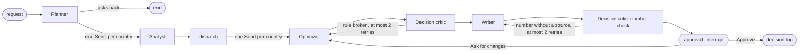

# StaffPilot Crew

A multi agent copilot for support staffing decisions. IE5374 Applied Generative AI, final project, Seven Team-5374.

A staffing manager types an open ended request, such as "Keep hiring in Brazil to at most 5 people a month and serve at least 98%". Five agents plan the work, review the data, run the optimizer, check every rule and number, and write the answer for the right reader. The run then pauses: nothing is applied until the manager approves an option or asks for changes.

The proposal is in [docs/PROPOSAL.md](docs/PROPOSAL.md), the choices made while building it in [docs/DECISIONS.md](docs/DECISIONS.md), and the related products in [docs/RELATED_PRODUCTS.md](docs/RELATED_PRODUCTS.md).

## How it works



| Agent | Role | What it does | Model step |
|---|---|---|---|
| Planner (supervisor) | reasoning | reads the request, the manager's limits and the reader; splits the work by country; asks back when a country or the change is missing | `reason` |
| Analyst | reasoning | seasonality, forecast, a team that is short or too large, the rule passages that apply (BM25 over the brief); the gap of a monthly update | `write` |
| Optimizer | optimization | the hackathon's integer program and day by day simulator on each option; a relaxed model when the limits cannot all be met; the automation share | none, only tools |
| Decision critic | decision making | compares the options, checks the brief's rules and the manager's limits, sends work back, checks every number against the FactLedger, pauses for approval | `decide` |
| Writer | generation | a chat reply for the staffing manager, a memo for a country manager, a note for finance, or a hiring and notice plan for the people team | `write` |

### What keeps it reliable

* **Parallel countries.** The Planner starts one Analyst and one Optimizer branch per country with LangGraph's `Send`. Every field the branches write has a reducer (`state.py`), so parallel writes merge instead of raising `InvalidUpdateError`.
* **Bounded loops.** The critic can send work back to the Optimizer at most 2 times and to the Writer at most 2 times, counted separately. The Writer's second retry runs on a stronger model chosen by the router. After the last retry the Optimizer's best option goes on with its open issues listed, and any sentence whose number still has no source is left out and flagged. A hard `recursion_limit` (60 steps) stops any run on top of the counters.
* **Numbers come from the planner.** The Analyst and the Optimizer put every figure into the hackathon's FactLedger; a model only writes `{{placeholders}}`, and the critic rejects any number the ledger does not hold.
* **Limits that cannot be met are explained.** When the optimizer cannot serve the goal under the manager's cap or budget, a small linear program of the year gives each limit a penalized slack variable. It is solved once per limit, and each estimate is checked and, if needed, corrected with the real optimizer. The option is marked as relaxed and says which limit moved and by how much.
* **Human in the loop.** The graph is compiled with a checkpointer (in memory for tests, SQLite for the app) and pauses with `interrupt` after the critic. **Approve** writes the decision to the `decision_log` table in `outputs/crew_app.sqlite` with the signed in user and ends the run; nothing is sent to any other system. **Ask for changes** writes the new limit into the saved state, resets the retry counters and resumes at the Optimizer, without running the Planner or the Analyst again.

### Models and routing

All model ids and prices live in [`src/staffpilot_crew/default_crew.toml`](src/staffpilot_crew/default_crew.toml) and can be overridden in `config/crew.toml`.

| Model | Id in the config | Steps assigned in the proposal | Accuracy the router starts from |
|---|---|---|---|
| Claude Sonnet 5.5 | `anthropic:claude-sonnet-5-5` | reason, decide | classify 100%, measured in the hackathon; others prior |
| GPT 5 nano | `openai:gpt-5-nano` | classify | classify 84%, measured in the hackathon; others prior |
| Gemini 3.5 Flash | `google_genai:gemini-3.5-flash` | write | prior only |
| Gemma 4 E4B, local | `local:google/gemma-4-e4b` | private mode | classify 88%, measured in the hackathon; others prior |
| Offline backend | none | tests, CI, no key | not a model |

The router looks at the step type (`classify`, `reason`, `decide`, `write`), the request's difficulty (how many countries, how many limits, and whether they pull against each other) and the user's mode:

* **Best quality:** the model assigned to the step, or the most accurate one that can be reached.
* **Lowest cost:** the cheapest hosted model whose accuracy clears the bar for the difficulty (80% simple, 88% moderate, 95% hard).
* **Private:** only the local model through LM Studio.

A "prior" value is a starting guess and is labelled as such in every routing record; `staffpilot-crew eval --online` measures each model on the crew's own questions and writes `eval/results/routing_table.csv`, which then replaces the priors. Each call records its model, the reason it was chosen, its time, its token counts and its cost: measured from tokens and the configured price, or marked "unknown price" when no price is configured (Gemini 3.5 Flash today).

## Run it

Python 3.11 to 3.13.

```bash
python -m venv .venv
source .venv/bin/activate
pip install -e ".[dev]"
```

On Windows use `.venv\Scripts\activate`. The install pulls the hackathon package from GitHub, pinned to the submitted commit.

**Without any key or data (synthetic sample):**

```bash
staffpilot-crew app --sample --offline
```

Open http://127.0.0.1:7861. The hackathon's own pages run unchanged at http://127.0.0.1:7861/planner/.

**With the course data:** save the course workbook as `data/raw/IE5374_Hackathon_Google_Data.xlsx` (it is not committed), then run `staffpilot-crew app`. Without the file the app falls back to the sample and says so.

**With models:** copy `.env.example` to `.env` and fill in the keys you have (`OPENAI_API_KEY`, `ANTHROPIC_API_KEY`, `GOOGLE_API_KEY`). Only providers with a key are used. For the private mode start LM Studio's server at `http://localhost:1234/v1` with `google/gemma-4-e4b` loaded. `STAFFPILOT_OFFLINE=1` or `--offline` hides every key.

**One request from the terminal:**

```bash
staffpilot-crew ask "Compare a Q3 growth push in the USA, Brazil and the UAE" --mode lowest_cost
```

## The app: a daily desk for each role

Each user signs in to **Today**, the work that waits on them. Questions to the crew go through the **Ask StaffPilot** sidebar on the right, so the numbers stay in view; when a question has options, the page moves to **Workspace**.

| Page | What it is for |
|---|---|
| Today | *Waiting on you*: the proposals whose next step is yours (select a row to open it). *Alerts* for your countries (from the plan, and new monthly data), with "Ask about it". *Hiring deadlines* of approved plans, marked On track, Due soon (7 days or less) or Overdue. Filters: My scope, All countries, Overdue or urgent, and by state |
| Proposals | every proposal with its state, the numbers it was made with (option cards with the change against the plan), the reasons it goes to Finance, a warning when its numbers are out of date, its **timeline**, the next actions for your role, a note box that every action requires, the hiring plan as CSV and the proposal text with a copy button |
| Workspace | the options of the latest question, each figure with its change against the plan the year started with and a **Verified numbers** (or **Unverified**) badge from the FactLedger; turn an option into a draft or submit it, change the limits and plan again, copy it as a country memo, finance note, hiring notice email or staffing summary, or save it as a scenario |
| Saved scenarios | your saved questions with their limits and results: reopen (the numbers come back; a copy runs afresh), rename, duplicate |
| Monthly check | enter the real sign ups so far; proposals for that country made earlier become out of date, and a gap above 10% (or a team change) also puts next month's proposal on Workspace |
| Decisions | every final approval, newest first |
| Full planner | the hackathon pages at /planner/ |
| Answer quality | admin and reviewer only: the router against each single model, with the Pareto chart |
| Users | admin only: every account and its password age (never the hashes) |

The agents' steps ("How this answer was worked out"), the model settings and the model cost are shown to the admin and reviewers only. "Show the answer as" rewrites an answer for another reader from the ledger, without a model call. When two options lead to the same plan, only one card is shown and it names its twin.

### How a proposal moves

```
Draft -> Pending Finance (only when needed) -> Pending approval -> Approved -> Hiring triggered -> Done
   \-> Withdrawn (by its creator)          \-> Returned (with a reason) -> revised into a new Draft
```

| Step | Who | Notes |
|---|---|---|
| Create a draft, submit, withdraw, revise | the proposal's creator: a staffing manager, or a country manager for their own country (and the admin) | revising puts the sidebar's latest options on a returned proposal |
| Confirm budget, or return | Finance | only proposals whose staffing cost moves more than 5% or $100,000 against the plan, whose hires change by more than 5 in a country, or that set a budget (all in `[workflow]` of the config) |
| Approve, or return | Staffing Manager | approving also approves the paused crew run, so the decision log gets its row as before |
| Start hiring, mark as done | People Team | |
| Refresh the numbers | the creator, Finance, a staffing manager | runs the request again on the latest data, keeping its limits and its choice |

Every action needs a note, and each one is a row of the timeline (`proposal_events`: time, who, their role, from which state to which, the note). A proposal is **out of date** when its country got newer data (a monthly check), the dataset changed, or it has waited more than 7 days; approval is then locked until its numbers are refreshed.

**Hiring deadlines** follow the lead time: agents needed from the start of month M must be hired one month earlier (`rules.ramp_months`), so the deadline is the first day of the month the plan decides them in. The CSV has the columns `country, month, current_headcount, recommended_hires, delta, target_deadline, approval_status, approved_by`; `current_headcount` is the agents of the plan the year started with, and `delta` is the change in hires against it.

**Not built, on purpose** (outside the course project): sending email or Slack messages, background jobs on a schedule, and a connection to a real HR system. The email text can be copied, the hiring plan downloaded as CSV, and every handoff shows up on the next person's Today page instead.

## Sign in and roles

The crew pages ask for a sign in. Users live in SQLite (`outputs/crew_app.sqlite`, table `users`, next to `decision_log`, `proposals`, `proposal_events`, `saved_scenarios` and `data_versions`); passwords are hashed with PBKDF2 SHA 256 and a random salt per user, using only Python's standard library.

On an empty database the app creates an administrator, a reviewer and five demo accounts; the administrator and the reviewer are also added to an older database. The sign in page does not list them; they are listed here. Change or remove them before any real use.

| Username | Password | Role | Country | Password age when created |
|---|---|---|---|---|
| `admin` (or `Admin`) | `Admin` | Admin, full rights | all | 0 days; the password is short on purpose, so every sign in with it asks for a new one |
| `reviewer` | `Reviewer2026` | Reviewer: reads everything and sees the technical panels, changes nothing | all | 0 days |
| `morgan` | `Manager2026` | Staffing Manager | all | 10 days |
| `linh` | `Vietnam2026` | Country Manager | Vietnam | 30 days |
| `rafael` | `Brazil2026` | Country Manager | Brazil | 120 days, to show the warning |
| `priya` | `Finance2026` | Finance | all | 45 days |
| `jordan` | `People2026` | People Team | all | 5 days |

**Password rule.** A password must be changed every 90 days (3 months). At sign in, a password 90 days old or more shows a warning banner with its age and how many days it is overdue. **Change password** asks for the current password and the new one twice; the new one needs at least 8 characters and must differ from the current one. A successful change sets `password_updated_at` to now and the banner disappears at once. The admin's `Admin` is the only password allowed under 8 characters, and only because it is seeded; signing in with it always shows a banner asking for a new one.

**What each role sees first.** The Writer view, the suggested questions and the Today list follow the role: a staffing manager starts on the staffing summary and the proposals pending approval; a country manager on the memo, their own country (a question that names no country uses theirs) and their drafts and returned proposals; Finance on the finance note and the proposals pending Finance; the People Team on the hiring and notice plan, approved proposals and the deadlines. Anyone can switch the view by hand.

**To try a full handoff with the course data:** sign in as `rafael`, pick "Keep hiring to at most 5 people a month and serve at least 98%" in the sidebar, write a note on Workspace and submit; sign in as `morgan`, open it from Today, write a note and approve; sign in as `jordan`, open it, start hiring and download the CSV. For the Finance step, submit a request that sets a budget, such as "Brazil needs to stay within a budget of $2M while serving at least 98%", and confirm it as `priya`. For the out of date lock, enter a monthly check for that country before approving. On the synthetic sample the demo countries (Vietnam, Brazil) are not in the data, so use the suggested questions as `morgan`.

`STAFFPILOT_AUTH_MODE` sets the mode: `required` (default), `optional` (a guest may look and run requests but not approve) or `disabled` (no form; the session is a staffing manager called "Local user"). The tests run with `disabled`, and test the sign in itself on a temporary database.

## Tests and evaluation

```bash
python -m pytest
ruff check .
```

98 tests run offline in about 30 seconds on synthetic data. They cover the normal path, three countries in parallel, asking back, both retry limits and the escalation, the recursion limit, the number check that drops made up figures, the relaxed model on limits that cannot be met, interrupt and resume from the Optimizer, a paused run surviving a restart with SQLite, the router in its three modes without keys, cost records, automation share and monitoring, and sign in: the users table and its demo accounts, right and wrong passwords, the 90 day warning, password changes, each role's Writer view and suggestions, who may approve, and the approver's identity in the decision log; and the proposal workflow: every state, the Finance thresholds, required notes, the timeline, out of date proposals and the approval lock, refreshing and revising, lead time deadlines, the CSV columns, saved scenarios and the Today page of each role. Online models are stood in for by scripted backends; no test calls a paid model.

The GitHub Actions workflow in `.github/workflows/ci.yml` runs the same checks but is set to start only by hand (Actions tab, Run workflow), so pushes use no Actions minutes. Its header says how to turn it back on for every push.

```bash
staffpilot-crew eval --sample
```

runs the 14 labelled sample requests (`src/staffpilot_crew/eval_questions.json`; 12 more for the course data). Offline every setup collapses to the deterministic backend, so that run checks the graph, not the models: it reaches 14 of 14. `staffpilot-crew eval --online` adds the router in each mode and each model alone; it prints the number of runs and asks before it spends anything.

## Known limits

* **No online evaluation yet.** Until `eval --online` is run, the router's choices for reason, decide and write rest on prior guesses, and the Pareto chart has a single point.
* **Budget is checked, not optimized.** The hackathon's integer program has no budget constraint, so a budget is checked after each plan and moved by the relaxed model; only the hiring cap and the service goal shape the plan itself.
* **The relaxed model is an estimate.** It is a monthly capacity model; every number shown comes from the real optimizer, which can need a little more than the estimate (the option then says so).
* **AI uplift is unknown.** The automation share's value is a range from 0% to 50% of a human agent's uplift, set in the config, not a measurement.
* **Gemini's price is not configured,** so its calls are counted but their cost shows as unknown.
* **Sign in protects the pages, not the files.** Anyone who can read `outputs/crew_app.sqlite` can read the decision log, and the demo accounts must be replaced before real use. There is no lockout after wrong passwords and no password reset by email.
* **The hackathon pages at /planner/ are not behind the crew's sign in;** they keep their own sign in only when started on their own.

## Repository

| Path | Contents |
|---|---|
| `src/staffpilot_crew/graph.py` | the LangGraph graph, the checkpointers and the runner |
| `src/staffpilot_crew/agents.py` | the five agents and the Writer's templates |
| `src/staffpilot_crew/state.py` | the typed state and its reducers |
| `src/staffpilot_crew/router.py`, `models.py`, `config.py`, `default_crew.toml` | the router, the model interface and its settings |
| `src/staffpilot_crew/planning.py`, `relax.py`, `constraints.py` | the door into the hackathon planner, the relaxed model, the manager's limits |
| `src/staffpilot_crew/auth.py` | users, passwords, the 90 day rule, roles and their rights |
| `src/staffpilot_crew/workflow.py`, `desk.py` | proposals, their timeline, out of date checks, deadlines, saved scenarios, the CSV and the Today page |
| `src/staffpilot_crew/monitoring.py`, `evaluation.py`, `app.py`, `cli.py` | monthly monitoring, evaluation, the web app and the command line |
| `tests/` | the offline tests |
| `eval/results/` | evaluation results |
| `docs/` | proposal, decisions, related products, AI use |

## How this repository relates to the hackathon

The optimizer, the simulator, the data loader, the FactLedger, the offline router and the model backends come from our Module 7 hackathon, [StaffPilot](https://github.com/lequo-neu/staffpilot). That repository is kept exactly as it was submitted; this project installs it as a library, pinned to the submitted commit (see `pyproject.toml`). Both repositories are public, so the install needs no GitHub sign in. Everything in this repository is new work for the final project.

## Team

Seven Team-5374, the same team as our Module 7 hackathon.

| Member | Lead on |
|---|---|
| Quoc Hung Le (Kevin) | graph, router, evaluation |
| Hamad Al Sulaimi | Optimizer agent, interface |
| Khoa Tran | Writer agent, role views, evaluation questions |

## AI use

See [docs/AI_USAGE.md](docs/AI_USAGE.md).
